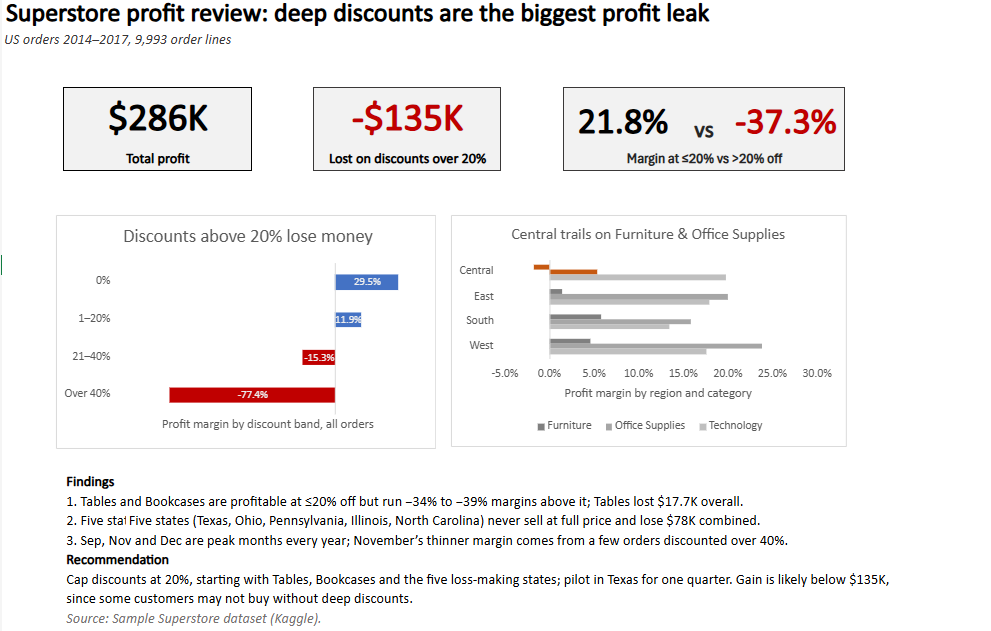

# Superstore Profit Review: Deep Discounts Are the Biggest Profit Leak

Excel analysis of 9,993 US retail order lines (2014–2017) to find where the business loses money and what to change.

## Business questions
1. Which product sub-categories lose money, and is heavy discounting the cause?
2. Which states generate high sales but negative profit, and why?
3. Which months are consistently strongest and weakest, and how should we plan around them?

## Data
[Sample - Superstore](https://www.kaggle.com/) dataset from Kaggle: one row per product line within an order (9,994 rows, 5,009 orders).

## Approach
- **Cleaning:** removed 1 exact duplicate row; verified no blanks, no numbers stored as text, no hidden spaces
- **New columns:** profit margin, discount band, order year/month, days to ship
- **Analysis:** SUMIFS/COUNTIFS tables, pivot tables by sub-category, state, region and month, with slicers
- **Hypothesis tests:** compared profit at ≤20% vs >20% discount within the same products and states
- **Reconciliation:** every breakdown checked against company totals ($2.30M sales, $286K profit)

## Key findings
1. **Discounts above 20% lost $135K**, nearly half of total profit ($286K). Orders at ≤20% off earn a 21.8% margin; above 20%, −37.3%.
2. **Tables and Bookcases** are profitable at ≤20% off (11.1% and 8.8% margins) but run −34% to −39% margins above it. Tables lost $17.7K overall.
3. **Five states** (Texas, Ohio, Pennsylvania, Illinois, North Carolina) never sell at full price, average 28–39% discounts, and lose $78K combined. In all five, orders at ≤20% off are profitable.
4. **Seasonality:** September, November and December peak every year. February is the slowest month but has the best margin (17.2%). November's thinner margin (10.1%) comes from a few orders discounted over 40%, not a seasonal pattern.

## Recommendation
**Cap discounts at 20%**, starting with Tables, Bookcases and the five loss-making states. Pilot in Texas for one quarter and compare profit with similar states.
The real gain will likely be below $135K, since some customers may not buy without deep discounts.

**Secondary:** review pricing for letter openers. None of the 10 products makes money even at low discounts, which turns the whole Supplies sub-category into a loss ($2.1K lost; the rest of Supplies earns $0.9K).

## Notes and limitations
- Discount and loss move together, and the ≤20% vs >20% comparison supports a causal link, but only a controlled test (the pilot) can prove it.
- Small exceptions not on the dashboard: one other Supplies product lost $8 (not material).
- Each letter-opener product has only 2–8 order lines; the finding rests on all 10 pointing the same way.

## Files
- `superstore_region_analysis.xlsx`: cleaned data, analysis sheets, pivots and dashboard
- `Dashboard.png`: Dashboard screenshot

## Tools
Excel (SUMIFS, COUNTIFS, XLOOKUP, pivot tables, slicers, charts)
